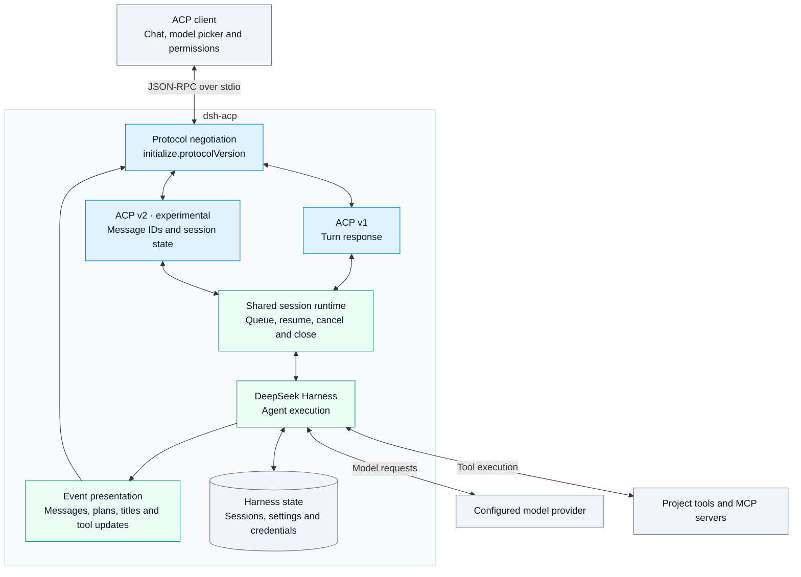

# DeepSeek Harness ACP

[English](README.md) | [简体中文](README.zh.md)

**ACP v1 + ACP v2 (experimental)** · Direct Harness integration · One shared session runtime

Run DeepSeek Harness in a local project from an Agent Client Protocol (ACP) client such as Dumbo or Zed. The client provides the chat interface and asks you to approve tool calls. Harness runs the model and tools. The `dsh-acp` adapter sends messages, task progress and tool results back to the client.

## Architecture



The same launch command supports both protocol versions. The client selects v1 or experimental v2 during initialization; no extra launch flag is needed. The adapter calls Harness directly. It does not relay the official Harness ACP server.

- Switch models and reasoning effort from the client.
- Show task plans, session titles, tool categories and context usage from Harness events.
- List and resume sessions, approve tools, cancel work and close sessions.
- With v2, use message IDs, separate execution-state updates, queued prompts and optional history replay.

Installing `dsh-acp` automatically installs Harness. No separate `dsh` installation or `cordis.yml` is needed.

## Connect a client

1. Install Node.js **24.9.0 or later**, then run:

   ```sh
   npm install -g @dumbo-ai/dsh-acp@0.8.0
   dsh-acp --version
   ```

   The version command should print `0.8.0`. The package installs its Harness dependencies.

2. Add a custom ACP agent to your client. Set the command to `dsh-acp`, leave its arguments empty and set `DEEPSEEK_API_KEY` in the agent process environment. For Dumbo, merge the following `dsh` entry into `acp-agent-config.json`:

   ```json
   {
     "acp_agent_servers": {
       "dsh": {
         "type": "custom",
         "command": "dsh-acp",
         "args": [],
         "env": { "DEEPSEEK_API_KEY": "your API key" }
       }
     }
   }
   ```

3. Restart the client, open your project directory, select the agent and send a message. If the client cannot find the executable, run `command -v dsh-acp` in your shell and use the absolute path as the command. Starting `dsh-acp` directly in a terminal leaves it waiting for a protocol message on standard input.

To try the adapter without a global install, set the client command to `npx` and its arguments to `["--yes", "@dumbo-ai/dsh-acp@0.8.0"]`.

## Models and environment

The bundled profile selects `deepseek-v4-flash` from `deepseek-official`. A client can change models through the session configuration and select a reasoning effort when the model supports it. To start new sessions with Pro, set the client arguments to `["--patch", "/absolute/path/to/acp.patch.yml"]` and use this patch:

```yaml
- id: dsh-acp
  config:
    provider: deepseek-official
    model: deepseek-v4-pro
```

You can pass `--patch` more than once. A patch replaces the target entry’s entire `config`, so include both provider and model. The bundled profile disables the official `acp` server to give this adapter exclusive access to standard input and output. The old `--config` option for complete configuration files has been removed. See the [bundled profile](assets/acp.patch.yml) and [example patch](examples/acp.patch.yml).

| Variable              | Purpose                                                                                                                             |
| --------------------- | ----------------------------------------------------------------------------------------------------------------------------------- |
| `DEEPSEEK_API_KEY`    | API key for the default DeepSeek service.                                                                                           |
| `DEEPSEEK_BASE_URL`   | Optional. Omit for the official Messages endpoint, `https://api.deepseek.com/anthropic`. A custom endpoint must support that route. |
| `DSH_HOME`            | Directory where Harness stores settings, credentials and sessions.                                                                  |
| `DSH_PERMISSION_MODE` | Harness permission preset, such as `read-only` or `workspace-write`.                                                                |

## Sessions, tools and protocol versions

Clients that support ACP configuration can select a permission preset for each session. The default profile offers `read-only`, `workspace-write` and `danger-full-access`. Changes update the session's sandbox and approval policy and are saved for reopening. Custom profiles supply their own preset labels and choices, and clients receive updates when the choices or current permissions change. A `custom` current value describes saved settings that match no available preset.

Harness enforces the selected policy. In particular, `danger-full-access` disables approval prompts, and tools that explicitly require approval are rejected under that policy.

The client negotiates ACP v1 or experimental v2 at startup. Both use the same Harness runtime. Clients can list sessions, resume a session in its original project directory, cancel work or close a session. Each session can use client-supplied stdio or HTTP MCP servers. When a tool needs approval, the client offers a one-time allow or reject choice.

| Client operation                | ACP v1                                 | Experimental ACP v2                                                                       |
| ------------------------------- | -------------------------------------- | ----------------------------------------------------------------------------------------- |
| Send a message                  | The request returns when the turn ends | Returns a message ID after insertion into the session; execution state arrives separately |
| Send another message while busy | Returns a busy error                   | Queues the message and acknowledges it when admitted                                      |
| Resume a session                | Restores context, title and plan       | Syncs current state; pass `replayFrom: { "type": "start" }` to replay message history     |

If you switch models or reasoning effort during a turn, the new choice applies to the next turn. You can reopen ordinary conversation forks created in 0.7.0 from the history list.

Session titles come from Harness and appear in updates and history listings when available. Tool updates carry a category, status and result. Plans come from the model’s task tool and clear at the start of the next turn. Text and reasoning stream as Harness produces them. Completion does not append the same text again. Cancelled or failed attempts retain their delivered prefix; retries use a separate message. V2 history replay restores those messages from the session log. Image input depends on the model and Harness configuration. Audio, embedded context, MCP-over-ACP, client file operations and terminal views are currently unsupported.

ACP v2 uses the experimental entrypoint in ACP SDK `2.1.0`; it is not a claim of a stable v2 specification. Cancellation and completion wait for the Harness turn to finish before admitting the next prompt. See the [protocol validation results](docs/releases/0.8.0.md) for tested behavior and limits.

## Run from source

```sh
pnpm install
pnpm check
```

`pnpm check` runs type checking, linting, the build and the test suite. After building, set your client command to the absolute path to Node and pass the absolute path to this checkout’s `dist/bin.js` as its argument. The project pins DeepSeek Harness to `0.2.2-rc.1` and the ACP SDK to `2.1.0`. Process tests run Harness with a deterministic model fixture and require no DeepSeek API key.

To embed the Cordis plugin, import `@dumbo-ai/dsh-acp/plugin` and supply the services declared in `inject`. In addition to the model settings, `sessionListPageSize` controls history pagination (default 100) and `stream` overrides the default stdio transport. See the [plugin entry point](src/plugin.ts), [session runtime](src/harness/runtime.ts) and [protocol design](docs/adr/0003-direct-acp-v1-v2.md).

## License

[Apache License 2.0](LICENSE). Some Harness integration code is adapted from the MIT-licensed upstream implementation. See [third-party notices](THIRD_PARTY_NOTICES.md) for attribution.
