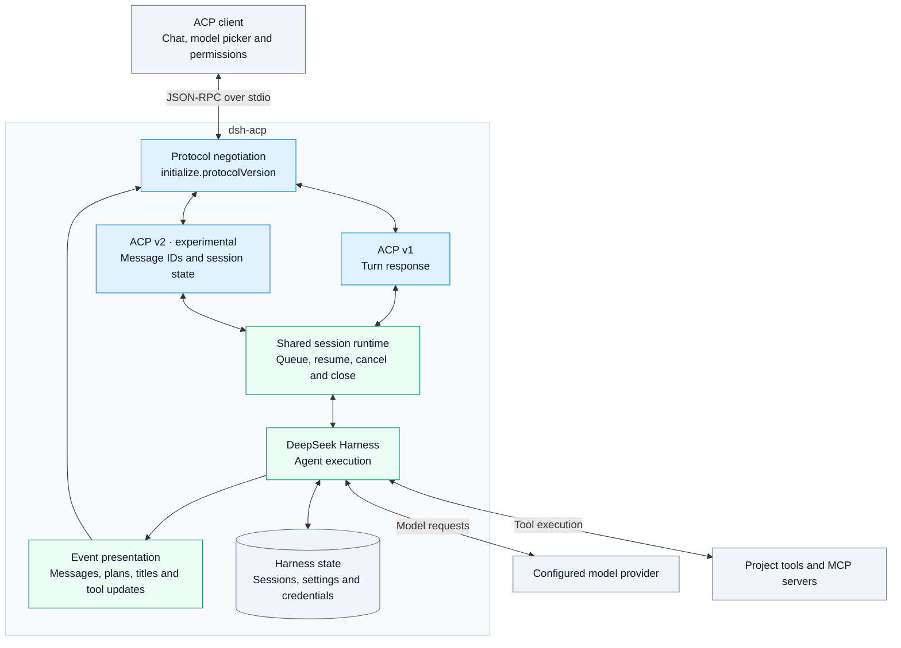

# DeepSeek Harness ACP

[English](README.md) | [简体中文](README.zh.md)

**支持 ACP v1 和 ACP v2（实验性）** · 直接接入 Harness · 共用一套会话实现

通过支持 Agent Client Protocol（ACP）的客户端，在本地项目中运行 DeepSeek Harness。客户端负责对话界面和工具授权，Harness 运行模型与工具，`dsh-acp` 把会话消息、任务进度和工具结果传回客户端。

## 架构



同一个启动命令支持两种协议，由客户端在初始化时选择 v1 或实验性 v2，不需要额外参数。适配器直接调用 Harness，不转发官方 ACP 服务。

- 在客户端切换模型和思考强度。
- 根据 Harness 事件展示任务计划、会话标题、工具分类和上下文用量。
- 列出、恢复、取消和关闭会话，并通过客户端确认工具权限。
- v2 支持消息 ID、独立执行状态、忙碌时排队和可选的历史回放。

安装 `dsh-acp` 会自动安装 Harness，不需要单独安装 `dsh`，也不需要准备 `cordis.yml`。

## 接入客户端

1. 安装 Node.js **24.9.0 或更高版本**，然后运行：

   ```sh
   npm install -g @dumbo-ai/dsh-acp@0.7.1
   dsh-acp --version
   ```

   版本命令应输出 `0.7.1`。安装包已包含所需的 Harness 依赖。

2. 在客户端添加自定义 ACP Agent。启动命令填 `dsh-acp`，参数留空，在该进程的环境变量中设置 `DEEPSEEK_API_KEY`。对 Dumbo，将下面的 `dsh` 条目合并到 `acp-agent-config.json`：

   ```json
   {
     "acp_agent_servers": {
       "dsh": {
         "type": "custom",
         "command": "dsh-acp",
         "args": [],
         "env": { "DEEPSEEK_API_KEY": "替换为你的 API Key" }
       }
     }
   }
   ```

3. 重启客户端，打开项目目录，选择刚添加的 Agent 并发送消息。若客户端找不到命令，在终端运行 `command -v dsh-acp`，将输出的绝对路径填入 `command`。直接运行 `dsh-acp` 时，它会等待客户端从标准输入发来协议消息。

临时试用时也可以将客户端的启动命令设为 `npx`，参数设为 `["--yes", "@dumbo-ai/dsh-acp@0.7.1"]`。

## 模型与运行环境

默认配置使用 `deepseek-official` 的 `deepseek-v4-flash`。客户端可通过会话配置切换模型；模型支持时，也可以选择思考强度。要让新会话默认使用 Pro，将客户端启动参数设为 `["--patch", "/absolute/path/to/acp.patch.yml"]`，补丁内容如下：

```yaml
- id: dsh-acp
  config:
    provider: deepseek-official
    model: deepseek-v4-pro
```

`--patch` 可以重复传入。补丁替换目标条目的整个 `config`，请同时填写 provider 和 model。内置配置已禁用官方 `acp` 服务，让此适配器独占标准输入输出。旧版完整配置文件 `--config` 已移除。见[内置配置](assets/acp.patch.yml)和[补丁示例](examples/acp.patch.yml)。

| 环境变量              | 用途                                                                                                            |
| --------------------- | --------------------------------------------------------------------------------------------------------------- |
| `DEEPSEEK_API_KEY`    | 默认官方服务使用的 API Key。                                                                                    |
| `DEEPSEEK_BASE_URL`   | 可选。官方 Messages 端点为 `https://api.deepseek.com/anthropic`；使用默认端点时可省略。自定义地址需兼容该路由。 |
| `DSH_HOME`            | 指定 Harness 保存设置、凭据和会话的目录。                                                                       |
| `DSH_PERMISSION_MODE` | 选择 Harness 权限预设，例如 `read-only` 或 `workspace-write`。                                                  |

## 会话、工具与协议

客户端会自动协商 ACP v1 或实验性 v2。两者共用 Harness 会话，可列出历史记录、在原项目目录恢复会话、取消任务或关闭会话。客户端可为会话提供 stdio 或 HTTP MCP 服务器。工具需要授权时，用户可以在客户端选择允许一次或拒绝。

| 客户端行为     | ACP v1                     | 实验性 ACP v2                                                           |
| -------------- | -------------------------- | ----------------------------------------------------------------------- |
| 发送一条消息   | 请求在本轮执行结束后返回   | 消息写入会话后返回消息 ID，执行状态另行通知                             |
| 运行中再次发送 | 返回忙碌错误               | 排队等待，轮到该消息时才确认接收                                        |
| 恢复已有会话   | 恢复上下文、标题和任务计划 | 默认同步当前状态；传入 `replayFrom: { "type": "start" }` 可回放历史消息 |

执行中切换模型或思考强度，会从下一轮生效。用 0.7.0 创建的普通会话分支，也能从历史列表里重新打开。

会话标题来自 Harness；有标题数据时，会显示在会话更新和历史列表中。工具调用带有类别、执行状态和结果。任务清单来自模型调用的任务工具，每轮开始时会清除上一轮清单。正文和思考内容在 Harness 提交消息后送达，界面可能一次收到一段内容。图片输入取决于模型和 Harness 配置；当前未提供音频、嵌入式上下文、MCP-over-ACP、客户端文件操作或终端视图。

ACP v2 使用 ACP SDK `2.1.0` 的实验性入口，不代表 v2 协议已经稳定。取消和结束都会等待 Harness 本轮执行退出，再接收下一轮消息。已验证的行为与限制见[协议验证记录](docs/releases/0.7.1.md)。

## 从源码运行

```sh
pnpm install
pnpm check
```

`pnpm check` 依次执行类型检查、lint、构建和测试。构建后，在客户端将启动命令设为 Node 的绝对路径，参数填入本仓库 `dist/bin.js` 的绝对路径。本项目固定使用 DeepSeek Harness `0.2.2-rc.1` 和 ACP SDK `2.1.0`。进程级测试用可预测的模型替身运行真实 Harness，无需 DeepSeek API Key。

程序化接入可从 `@dumbo-ai/dsh-acp/plugin` 导入 Cordis 插件。宿主需提供插件声明的 `inject` 服务；除模型设置外，`sessionListPageSize` 控制历史列表每页条数（默认 100），`stream` 可替换默认的标准输入输出。实现见[插件入口](src/plugin.ts)、[会话运行时](src/harness/runtime.ts)和[协议设计说明](docs/adr/0003-direct-acp-v1-v2.md)。

## 许可证

项目使用 [Apache License 2.0](LICENSE)。部分 Harness 接入代码改编自 MIT 许可的官方实现，署名和许可声明见[第三方许可](THIRD_PARTY_NOTICES.md)。
